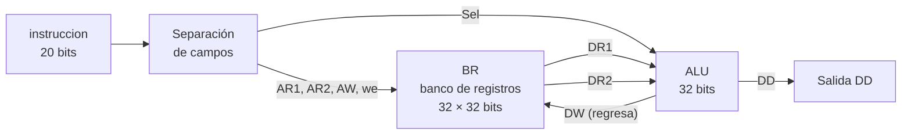
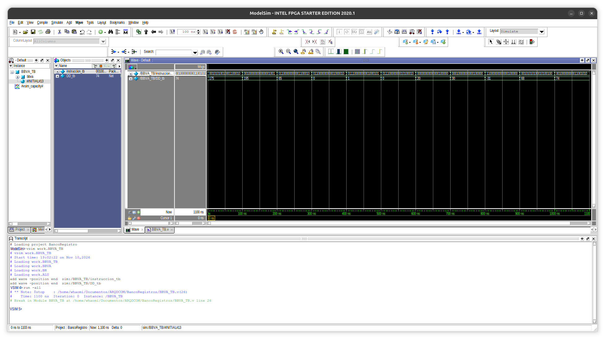
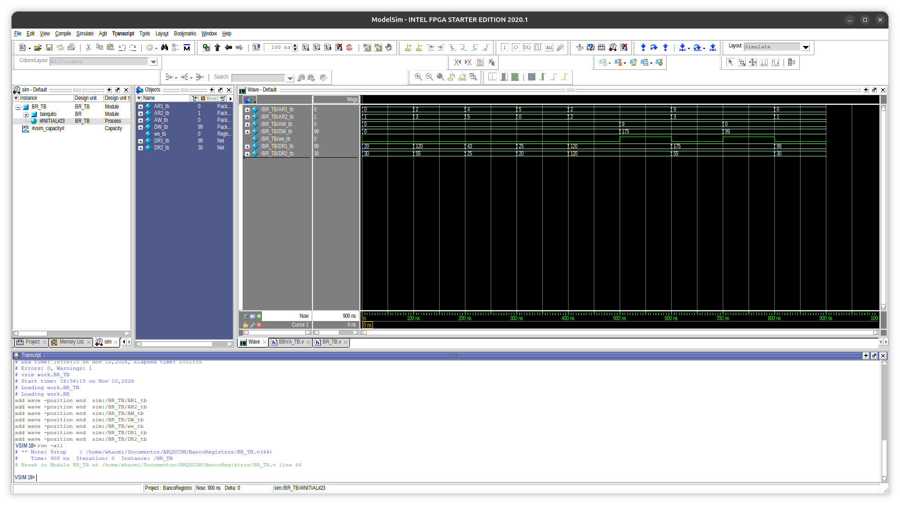

# BBVA: banco de registros + ALU

Sistema en Verilog que ejecuta instrucciones de 20 bits: lee dos registros de un banco de 32 registros, opera con una ALU de 32 bits y puede guardar el resultado en un tercer registro. Es la ruta de datos básica de una instrucción tipo R de MIPS.

Actividad de la materia *Arquitectura de Computadoras*, CUCEI, Universidad de Guadalajara (2026B).

El profesor nos dio el diseño en el pizarrón y parte del código como guía; nosotros lo adaptamos y completamos.

## Ruta de datos



El banco lee dos registros al mismo tiempo (`DR1` y `DR2`), la ALU opera con ellos y el resultado `DD` regresa al banco por `DW`. Si `we = 1`, ese resultado se guarda en el registro `AW`.

## Formato de instrucción (20 bits)

| Bits | Campo | Ancho | Función |
|---|---|---|---|
| 19–16 | `Sel` | 4 | Operación de la ALU |
| 15 | `we` | 1 | `1` = guarda el resultado en `AW` |
| 14–10 | `AW` | 5 | Registro destino |
| 9–5 | `AR2` | 5 | Segundo registro a leer (entrada B) |
| 4–0 | `AR1` | 5 | Primer registro a leer (entrada A) |

## Operaciones de la ALU

| `Sel` | Operación |
|---|---|
| `0000` | AND |
| `0001` | OR |
| `0010` | Suma (ADD) |
| `0110` | Resta (SUB) |
| `0111` | SLT con signo |
| `1100` | NOR |

## Módulos

| Archivo | Contenido |
|---|---|
| `BR.v` | Banco de 32 registros de 32 bits, con dos puertos de lectura y uno de escritura |
| `ALU.v` | ALU de 32 bits con bandera `Zero` |
| `BBVA.v` | Separa los campos de la instrucción y conecta el banco con la ALU |
| `BR_TB.v` | Testbench del banco de registros |
| `BBVA_TB.v` | Testbench del sistema completo |
| `datos.txt` | Valores iniciales de los registros |

## Resultados

Las 11 instrucciones de prueba dan el resultado esperado:

| Instrucción | Operación | Lee | DD |
|---|---|---|---|
| `0010 1 01001 00011 00010` | ADD | 120 + 55 | **175** → se guarda en reg 9 |
| `0010 0 00000 00000 01001` | ADD | 175 + 20 | **195** |
| `0110 0 00000 00011 00010` | SUB | 120 − 55 | 65 |
| `0110 0 00000 00010 00010` | SUB | 120 − 120 | 0 |
| `0111 0 00000 00010 00101` | SLT | 25 < 120 | 1 |
| `0111 0 00000 00101 00010` | SLT | 120 < 25 | 0 |
| `0000 0 00000 00001 00000` | AND | 20 & 30 | 20 |
| `0001 0 00000 00001 00000` | OR | 20 \| 30 | 30 |
| `1100 0 00000 00001 00000` | NOR | ~(20 \| 30) | −31 (`ffffffe1`) |
| `0010 1 01010 00101 00100` | ADD | 43 + 25 | **68** → se guarda en reg 10 |
| `0010 0 00000 00110 01010` | ADD | 68 + 6 | **74** |

La segunda instrucción comprueba la escritura: lee el registro 9 y ya trae el 175 que guardó la primera. Lo mismo pasa con la décima y la undécima. El −31 del NOR es `ffffffe1` leído como decimal con signo: el NOR invierte los 32 bits.



### Prueba del banco de registros (BR_TB)

`BR_TB` prueba el banco solo, sin la ALU: lee los valores iniciales, escribe 175 en el registro 9 y 99 en el registro 0, y los vuelve a leer.

| t (ns) | we | AW | DW | AR1 | AR2 | DR1 | DR2 |
|---|---|---|---|---|---|---|---|
| 0 | 0 | — | — | 0 | 1 | 20 | 30 |
| 100 | 0 | — | — | 2 | 3 | 120 | 55 |
| 200 | 0 | — | — | 4 | 5 | 43 | 25 |
| 300 | 0 | — | — | 5 | 0 | 25 | 20 |
| 400 | 0 | — | — | 2 | 2 | 120 | 120 |
| 500 | **1** | 9 | 175 | 2 | 2 | 120 | 120 |
| 600 | 0 | — | — | 9 | 3 | **175** | 55 |
| 700 | **1** | 0 | 99 | 9 | 3 | 175 | 55 |
| 800 | 0 | — | — | 0 | 1 | **99** | 30 |



## ¿Qué tan cerca está de un procesador?

BBVA es la parte central de un procesador: la que ejecuta una instrucción aritmética. En un procesador MIPS, una instrucción como `add $t1, $t2, $t3` hace exactamente esto: lee dos registros, los suma en la ALU y guarda el resultado en un tercer registro.

Los campos de la instrucción de BBVA corresponden a los de una instrucción tipo R de MIPS:

| BBVA (20 bits) | MIPS tipo R (32 bits) | Función |
|---|---|---|
| `AR1` | `rs` | Primer registro fuente |
| `AR2` | `rt` | Segundo registro fuente |
| `AW` | `rd` | Registro destino |
| `Sel` | `opcode` + `funct` | Qué operación hace la ALU |
| `we` | señal `RegWrite` de la unidad de control | Si se guarda o no el resultado |

En MIPS, `Sel` y `we` no vienen directo en la instrucción: una **unidad de control** los calcula a partir del `opcode` y el `funct`.

### Lo que tiene y lo que le falta

| Parte de un procesador | ¿BBVA la tiene? |
|---|---|
| Banco de registros | Sí |
| ALU | Sí |
| Escritura del resultado en un registro | Sí |
| Formato de instrucción con campos | Sí |
| Memoria de instrucciones | No: las instrucciones vienen del testbench |
| Contador de programa (PC) | No: no avanza solo a la siguiente instrucción |
| Reloj | No: todo es combinacional |
| Unidad de control | No: `Sel` y `we` vienen directo de la instrucción |
| Memoria de datos (`lw` y `sw`) | No |
| Saltos (`beq`) | No, aunque la ALU ya calcula la bandera `Zero` que se usaría para eso |

[RARO SUPREME](https://github.com/LeoCamposSec/raro-supreme-verilog) ya tiene una memoria de instrucciones y una memoria de datos. Juntando los dos diseños y agregando un reloj, un contador de programa y una unidad de control, se obtiene un **procesador MIPS de un solo ciclo**.

## Cómo ejecutarlo

`datos.txt` debe estar en la carpeta donde corres la simulación, porque `BR.v` lo carga con `$readmemb`.

**ModelSim:** crea un proyecto con todos los `.v`, compílalos y simula `BBVA_TB` (o `BR_TB` para probar solo el banco).

**Icarus Verilog:**

```bash
iverilog -o sim.out ALU.v BR.v BBVA.v BBVA_TB.v
vvp sim.out
```

## Lo que aprendí

- **El resultado regresa al banco.** `DW` no viene de afuera: es la salida de la ALU. Así funciona una instrucción tipo R: leer, operar y escribir.
- **Los warnings sí importan.** Declaré `DW` de 5 bits en vez de 32. ModelSim no marcó error, solo un warning de tamaño de puerto, y truncaba los datos en silencio: el 175 se guardaba como 15 y la segunda instrucción daba 35 en vez de 195. `DW` es un dato de 32 bits; solo las direcciones (`AR1`, `AR2`, `AW`) son de 5.
- **Dos lecturas al mismo tiempo.** El banco necesita dos puertos de lectura para alimentar las dos entradas de la ALU en la misma instrucción.
- **Un lazo combinacional puede colgar la simulación.** Si `AW` apunta al mismo registro que se está leyendo y `we = 1`, el resultado cambia el registro, el registro cambia el resultado y así sin fin.

## Limitaciones y siguientes pasos

- La escritura ocurre en un `always @*` sin reloj, por eso existe el lazo descrito arriba. Nunca uses como destino (`AW`) un registro que también se lee en la misma instrucción con `we = 1`.
- **Siguiente paso:** escribir en el banco solo en el flanco de subida de un reloj (`always @(posedge clk)`). Eso elimina el lazo y es como lo hace un procesador real.
